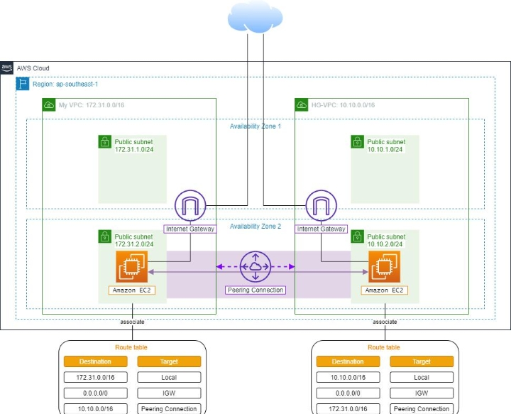
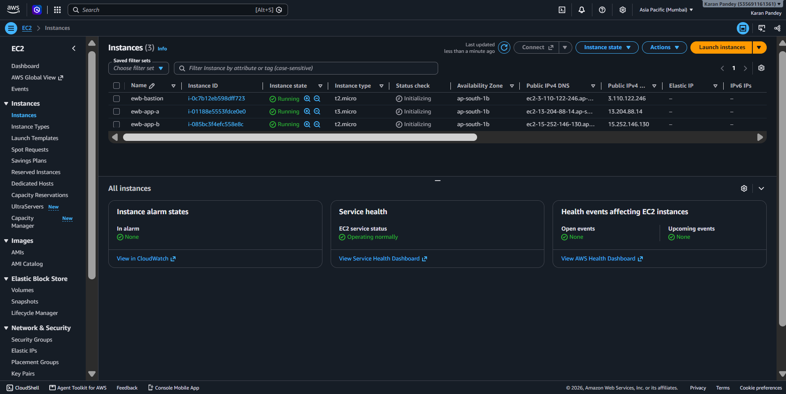
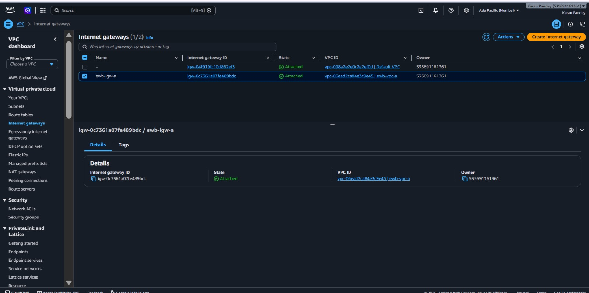
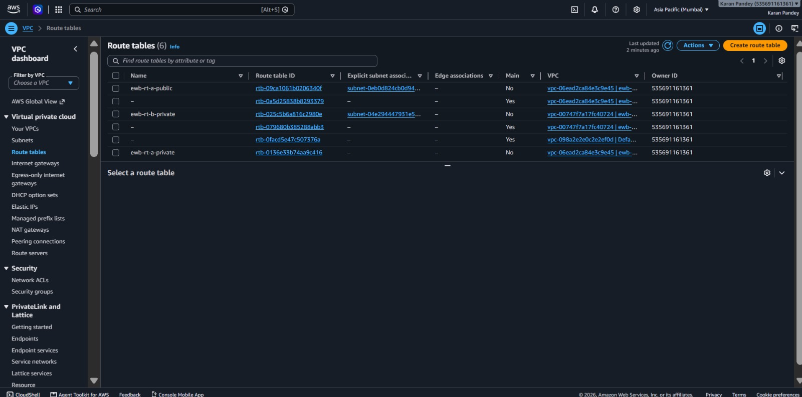
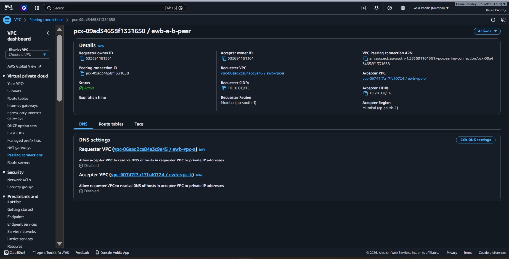

# AWS VPC Peering Project

Connected two VPCs in the same region (Mumbai, ap-south-1) using VPC Peering, so that private EC2 instances can communicate over private IP addresses.

## Architecture

- VPC A (ewb-vpc-a): 10.10.0.0/16
  - Public subnet (ewb-a-public): 10.10.1.0/24 (Bastion host)
  - Private subnet (ewb-a-private): 10.10.2.0/24 (App-A)
  - Internet Gateway: ewb-igw-a
- VPC B (ewb-vpc-b): 10.20.0.0/16
  - Private subnet (ewb-b-private): 10.20.1.0/24 (App-B)
  - No Internet Gateway
- Peering connection: ewb-a-b-peer (Active)

## Implementation

### 1. VPC A

### 2. VPC B

### 3. Public and Private Subnets

### 4. EC2 Instances

### 5. Internet Gateway

### 6. Route Tables

### 7. VPC Peering Connection (Active)

## Routing

- ewb-rt-a-public: 0.0.0.0/0 to Internet Gateway, 10.20.0.0/16 to peering connection
- ewb-rt-a-private: 10.20.0.0/16 to peering connection
- ewb-rt-b-private: 10.10.0.0/16 to peering connection

## Testing

- Connected to the bastion host over SSH, then to App-A and App-B using ProxyJump
- From App-A: ping -c 4 10.20.1.10
- From App-B: ping -c 4 10.10.2.10

## Key Learnings

- CIDR blocks of peered VPCs must not overlap
- Peering is non-transitive
- Both VPCs need routes pointing to the peering connection (forward and return path)
- Security groups must allow the peer traffic (SSH and ICMP)
- Active peering alone does not guarantee connectivity

## Services Used

VPC, Subnets, Route Tables, Internet Gateway, VPC Peering, EC2, Security Groups
